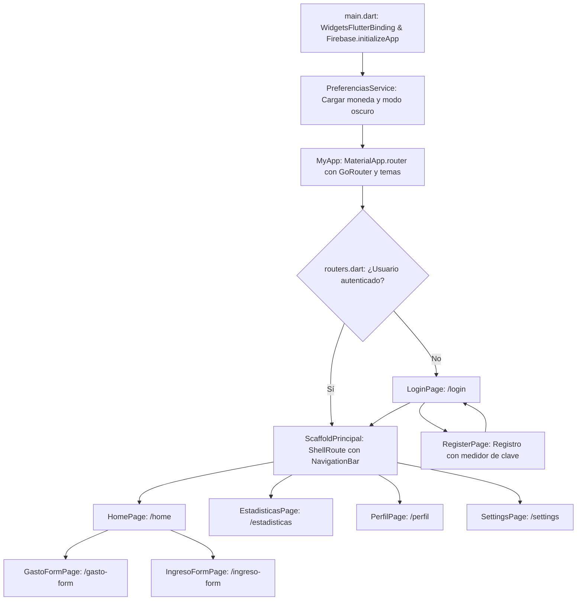

# 📘 Guía Completa de Exposición: Gestor de Gastos Personales

> **Propósito de este documento**: Servir como guía de estudio y guion de presentación para exponer con total claridad, seguridad y dominio técnico el proyecto de desarrollo móvil ante el docente y compañeros de clase.

---

## 1. Resumen Ejecutivo (Pitch de la Aplicación)

**Problema que resuelve**: La desorganización financiera y la falta de visibilidad en los gastos cotidianos de las personas.  
**Para quién es**: Dirigida a estudiantes y jóvenes profesionales que necesitan controlar su dinero de forma rápida y sencilla desde su teléfono.  
**Qué hace la app**: Permite registrar ingresos y gastos clasificados por categorías en tiempo real con sincronización en la nube (Firebase), calcula automáticamente el disponible mensual, visualiza estadísticas interactivas con gráficas analíticas, permite personalizar perfil y preferencias (moneda y tema oscuro), y ofrece carga de datos de prueba para demostraciones.

---

## 2. Tecnologías y Librerías Utilizadas

Todo el proyecto está desarrollado sobre **Flutter** (versión 3.13+ con Material 3) y el lenguaje **Dart**.

| Tecnología / Paquete | Versión | Para qué se usa exactamente | Dónde se usa en el código |
| :--- | :--- | :--- | :--- |
| **Flutter & Dart SDK** | `^3.13.2` | Framework multiplataforma y lenguaje base del aplicativo. | En todo el proyecto. |
| **firebase_core** | `^5.1.0` | Inicializa la conexión entre la app Flutter y los servicios de Firebase. | `lib/main.dart`, `lib/firebase_options.dart` |
| **firebase_auth** | `^7.0.1` | Gestión de cuentas, inicio de sesión, registro y nombre de usuario en Auth. | `lib/services/auth_service.dart`, `lib/services/perfil_service.dart`, `lib/routers.dart` |
| **cloud_firestore** | `^7.1.0` | Base de datos NoSQL en la nube con sincronización reactiva en tiempo real. | `lib/services/gasto_service.dart`, `ingreso_service.dart`, `perfil_service.dart`, `demo_data_service.dart` |
| **go_router** | `^18.0.2` | Enrutamiento declarativo, protección de rutas privadas (`redirect`) y barra de navegación (`ShellRoute`). | `lib/routers.dart`, `lib/widgets/scaffold_principal.dart` |
| **shared_preferences** | `^2.5.6` | Almacenamiento local en el dispositivo para recordar la moneda y el modo oscuro. | `lib/services/preferencias_service.dart`, `lib/main.dart` |
| **google_fonts** | `8.2.1` | Tipografía moderna y profesional ("Manrope") integrada al tema visual. | `lib/theme/app_theme.dart` |
| **intl** | `^0.20.3` | Formateo numérico de monedas (COP, USD, EUR) y localización de fechas en español. | `lib/theme/app_theme.dart`, `lib/pages/home_page.dart`, `lib/pages/estadisticas_page.dart`, `lib/main.dart` |
| **image_picker** | `^1.2.4` | Selección de fotografías desde la galería del dispositivo sin dependencias de `dart:io`. | `lib/pages/perfil_page.dart` |
| **fl_chart** | `^1.3.1` | Gráficas interactivas analíticas (barras por día, dona por categoría y comparativo 6 meses). | `lib/pages/estadisticas_page.dart`, `lib/widgets/resumen_ultimos_7_dias.dart` |
| **cupertino_icons** | `^1.0.8` | Conjunto de íconos auxiliares de Flutter. | `pubspec.yaml` |
| **flutter_test** | SDK | Entorno para pruebas unitarias de configuración y rutas. | `test/widget_test.dart` |

---

## 3. Estructura del Proyecto

El proyecto aplica una **arquitectura por capas desacoplada** donde las pantallas nunca invocan a Firebase directamente, sino a través de servicios especializados:

```text
flutter_proyecto/
│
├── lib/
│   ├── models/                         # Clases de datos inmutables y mapeo
│   │   ├── gasto_model.dart            # Modelo Gasto (id, monto, categoria, descripcion, fecha)
│   │   ├── ingreso_model.dart          # Modelo Ingreso (id, monto, descripcion, fecha)
│   │   └── perfil_model.dart           # Modelo PerfilUsuario (avatarId, fotoBase64)
│   │
│   ├── services/                       # Lógica de negocio y persistencia (Regla AGENTS.md)
│   │   ├── auth_service.dart           # Login, registro, logout y captura de errores de Auth
│   │   ├── gasto_service.dart          # CRUD y Streams en Firestore (usuarios/{uid}/gastos)
│   │   ├── ingreso_service.dart        # CRUD y Streams en Firestore (usuarios/{uid}/ingresos)
│   │   ├── perfil_service.dart         # Lectura y guardado de perfil (usuarios/{uid}/perfil/datos)
│   │   ├── preferencias_service.dart   # Guardado local con SharedPreferences (moneda y tema)
│   │   └── demo_data_service.dart      # Generación y limpieza de datos demo con WriteBatch
│   │
│   ├── theme/                          # Identidad visual y diseño fintech
│   │   └── app_theme.dart              # Temas claro/oscuro, AppColorsExtension y formateador de moneda
│   │
│   ├── pages/                          # Pantallas (Vistas principales de la app)
│   │   ├── login_page.dart             # Inicio de sesión con correo y contraseña
│   │   ├── register_page.dart          # Registro con barra de 4 niveles de fortaleza de clave
│   │   ├── home_page.dart              # Dashboard principal: saldo, acciones, minigráfico y movimientos
│   │   ├── gasto_form_page.dart        # Formulario para registrar y editar gastos con DatePicker
│   │   ├── ingreso_form_page.dart      # Formulario para registrar y editar ingresos
│   │   ├── estadisticas_page.dart      # Gráficas interactivas con fl_chart (día, categoría, 6 meses)
│   │   ├── perfil_page.dart            # Perfil, subida de foto Base64, 8 avatares y logout
│   │   └── settings_page.dart          # Ajuste de moneda, modo oscuro y gestión de datos demo
│   │
│   ├── widgets/                        # Componentes visuales reutilizables
│   │   ├── acciones_rapidas.dart       # Botones para agregar gasto o ingreso
│   │   ├── campo_texto.dart            # TextFormField estilizado según el tema fintech
│   │   ├── encabezado_seccion.dart     # Título de sección con badges y acciones
│   │   ├── fila_categoria.dart         # Barra porcentual de gastos por categoría
│   │   ├── fila_movimiento.dart        # Ítem de transacción con ícono, deslizar o borrar
│   │   ├── resumen_ultimos_7_dias.dart # Widget compacto en Home con gráfico de 7 días
│   │   ├── scaffold_principal.dart     # Barra de navegación inferior (Inicio, Stats, Perfil, Ajustes)
│   │   ├── tarjeta_saldo.dart          # Tarjeta principal verde con saldo y botón de ocultar
│   │   └── user_avatar.dart            # Avatar con prioridad: foto Base64 -> avatar predeterminado -> inicial
│   │
│   ├── firebase_options.dart           # Credenciales autogeneradas de Firebase por plataforma
│   ├── routers.dart                    # GoRouter con redirect de sesión y ShellRoute
│   └── main.dart                       # Punto de entrada de la aplicación
│
├── test/
│   └── widget_test.dart                # Prueba unitaria de verificación de rutas
├── pubspec.yaml                        # Definición de dependencias y versiones
├── firebase.json                       # Configuración CLI de Firebase
└── AGENTS.md                           # Reglas y principios arquitectónicos del proyecto
```

---

## 4. Cómo Funciona: Flujo Completo Paso a Paso



### Paso 1: Arranque e Inicialización (`lib/main.dart`)
1. Se invoca `WidgetsFlutterBinding.ensureInitialized()`.
2. Se ejecuta `Firebase.initializeApp()` con las opciones de `firebase_options.dart`.
3. Se configuran los símbolos de fecha en español (`initializeDateFormatting('es_CO', null)`).
4. `PreferenciasService.inicializar()` lee de `SharedPreferences` la moneda y el modo oscuro elegidos previamente.
5. Se construye `MyApp`, el cual escucha a `PreferenciasService` mediante un `ListenableBuilder` para cambiar de tema (claro/oscuro) en caliente sin reiniciar.

### Paso 2: Control de Acceso y Rutas (`lib/routers.dart`)
- `AuthNotifier` escucha el stream `FirebaseAuth.instance.authStateChanges()`.
- La función `redirect` de GoRouter valida cada navegación:
  - Si el usuario **no está logueado** y busca una ruta protegida $\rightarrow$ Redirige forzosamente a `/login`.
  - Si el usuario **ya está logueado** e intenta entrar a login o registro $\rightarrow$ Redirige a `/home`.
- `ShellRoute` envuelve a las pantallas principales dentro de `ScaffoldPrincipal`, manteniendo persistente la barra de navegación inferior.

### Paso 3: Autenticación de Usuarios (`lib/pages/login_page.dart` y `register_page.dart`)
- El usuario ingresa correo y contraseña.
- `RegisterPage` evalúa dinámicamente la contraseña en 4 niveles (8+ caracteres, mayúsculas, números y símbolos) y pinta un `LinearProgressIndicator` con colores reactivos.
- Las pantallas invocan a `AuthService().ingresar()` o `AuthService().registrar()`. Los errores de Firebase se traducen a español mediante `mensajeDeError()`.

### Paso 4: Panel Principal (`lib/pages/home_page.dart`)
- Consume 3 Streams en tiempo real mediante `StreamBuilder`:
  1. `GastoService().obtenerGastos()`: lista de gastos del usuario.
  2. `IngresoService().obtenerIngresos()`: lista de ingresos del usuario.
  3. `PerfilService().obtenerPerfil()`: datos de avatar y personalización.
- Muestra el saludo con el nombre del usuario (o parte previa a la arroba de su correo).
- Calcula: `Disponible = Ingresos del mes - Gastos del mes`. Si es negativo, se resalta en color de alerta.
- Muestra un botón de ojo para ocultar montos (`••••`) por privacidad.
- Contiene el widget compacto `ResumenUltimos7Dias` con acceso directo a estadísticas.
- Lista combinada de movimientos cronológicos: permite deslizar (`Dismissible`) para eliminar o tocar para editar.

### Paso 5: Registro y Edición (`gasto_form_page.dart` e `ingreso_form_page.dart`)
- Formularios validados que capturan monto, descripción, fecha (`showDatePicker`) y categoría (en gastos hay 9 categorías seleccionables).
- Si se envía un objeto existente (`state.extra`), la pantalla entra en modo edición y activa el botón de eliminación directa.

### Paso 6: Estadísticas Interactivas (`lib/pages/estadisticas_page.dart`)
- **Gasto por día**: Gráfico de barras (`fl_chart`) con selector de rango de fechas (`showDateRangePicker`). Resalta el día pico y el día más bajo. Muestra total, promedio diario, día más caro y día más barato.
- **Gastos por categoría**: Gráfico tipo dona (`PieChart`). Tocar cualquier sección amplía el radio y proyecta en el centro de la dona el nombre, monto y porcentaje.
- **Ingresos vs gastos**: Gráfico de barras agrupadas que compara mes a mes los últimos 6 meses.

### Paso 7: Perfil de Usuario (`lib/pages/perfil_page.dart`)
- Despliega `UserAvatar` con la jerarquía: foto Base64 $\rightarrow$ ícono de avatar $\rightarrow$ inicial.
- Al pulsar "Editar perfil" se abre un modal inferior (`showModalBottomSheet`):
  - Modifica el nombre (`currentUser.updateDisplayName`).
  - Sube una foto desde la galería (`ImagePicker`), escalada a 256x256 con calidad 70, convertida a Base64 usando `XFile.readAsBytes()` (sin usar `dart:io`, funcionando en Web y Android).
  - Permite elegir entre una cuadrícula de 8 avatares temáticos.

### Paso 8: Ajustes y Datos de Demostración (`lib/pages/settings_page.dart`)
- Permite alternar la moneda (`COP`, `USD`, `EUR`) y activar/desactivar el modo oscuro.
- Cuenta con los botones **Cargar datos de demostración** y **Borrar datos de demostración** que llaman a `DemoDataService` con confirmación por diálogo y alertas `SnackBar`.

---

## 5. Explicación del Código Clave (Archivos Esenciales)

### 1. `lib/routers.dart` — Redirección reactiva y ShellRoute
```dart
// Notificador que escucha cambios de sesión en Firebase
class AuthNotifier extends ChangeNotifier {
  AuthNotifier() {
    _sub = AuthService().cambiosDeAutenticacion.listen((_) => notifyListeners());
  }
  late final StreamSubscription _sub;
}

// Configuración de GoRouter con protección de rutas
final GoRouter appRouter = GoRouter(
  initialLocation: AppRoutes.login,
  refreshListenable: _authNotifier,
  redirect: (context, state) {
    final bool logueado = AuthService().estaAutenticado;
    final bool enRutaAuth = state.matchedLocation == AppRoutes.login ||
                            state.matchedLocation == AppRoutes.register;

    if (!logueado && !enRutaAuth) return AppRoutes.login; // Bloquea acceso no autorizado
    if (logueado && enRutaAuth) return AppRoutes.home;     // Evita volver al login si ya entró
    return null;
  },
  routes: [
    GoRoute(path: AppRoutes.login, builder: (context, state) => const LoginPage()),
    GoRoute(path: AppRoutes.register, builder: (context, state) => const RegisterPage()),
    // ShellRoute integra la barra de navegación persistente
    ShellRoute(
      builder: (context, state, child) => ScaffoldPrincipal(child: child),
      routes: [
        GoRoute(path: AppRoutes.home, builder: (context, state) => const HomePage()),
        GoRoute(path: AppRoutes.estadisticas, builder: (context, state) => const EstadisticasPage()),
        GoRoute(path: AppRoutes.perfil, builder: (context, state) => const PerfilPage()),
        GoRoute(path: AppRoutes.settings, builder: (context, state) => const SettingsPage()),
      ],
    ),
    // Rutas independientes fuera del shell
    GoRoute(path: AppRoutes.gastoForm, builder: (context, state) => GastoFormPage(gasto: state.extra as Gasto?)),
    GoRoute(path: AppRoutes.ingresoForm, builder: (context, state) => IngresoFormPage(ingreso: state.extra as Ingreso?)),
  ],
);
```

### 2. `lib/services/gasto_service.dart` — Sincronización en tiempo real
```dart
class GastoService {
  final FirebaseFirestore _firestore = FirebaseFirestore.instance;
  final AuthService _authService = AuthService();

  // Colección privada del usuario: usuarios/{uid}/gastos
  CollectionReference<Map<String, dynamic>>? get _coleccionGastos {
    final uid = _authService.usuarioActual?.uid;
    if (uid == null) return null;
    return _firestore.collection('usuarios').doc(uid).collection('gastos');
  }

  // Stream que emite la lista ordenada en tiempo real cada vez que Firestore cambia
  Stream<List<Gasto>> obtenerGastos() {
    final coleccion = _coleccionGastos;
    if (coleccion == null) return Stream.value([]);
    return coleccion
        .orderBy('fecha', descending: true)
        .snapshots()
        .map((snapshot) => snapshot.docs.map((doc) => Gasto.fromMap(doc.data(), doc.id)).toList());
  }

  Future<void> agregar(Gasto gasto) async => await _coleccionGastos?.add(gasto.toMap());
  Future<void> editar(Gasto gasto) async => await _coleccionGastos?.doc(gasto.id).update(gasto.toMap());
  Future<void> eliminar(String id) async => await _coleccionGastos?.doc(id).delete();
}
```

### 3. `lib/services/demo_data_service.dart` — Generación por lotes (`WriteBatch`)
```dart
class DemoDataService {
  final FirebaseFirestore _firestore = FirebaseFirestore.instance;
  final AuthService _authService = AuthService();

  Future<int> cargarDemo() async {
    final uid = _authService.usuarioActual?.uid;
    if (uid == null) throw Exception('No hay usuario autenticado.');
    
    await borrarDemo(); // Evita duplicar datos si se presiona dos veces

    final random = Random(42); // Semilla fija para reproducibilidad
    WriteBatch batch = _firestore.batch();
    int ops = 0, total = 0;

    // Se generan ingresos y gastos de los últimos 6 meses...
    // Cada documento lleva: 'demo': true
    
    // Si se acerca al límite de Firestore (500), se hace commit intermedio
    if (ops >= 450) {
      await batch.commit();
      batch = _firestore.batch();
      ops = 0;
    }
    await batch.commit();
    return total;
  }

  // Borra únicamente los documentos marcados con demo == true
  Future<int> borrarDemo() async {
    final uid = _authService.usuarioActual?.uid;
    final snapGastos = await _firestore.collection('usuarios').doc(uid).collection('gastos')
        .where('demo', isEqualTo: true).get();
    
    WriteBatch batch = _firestore.batch();
    for (final doc in snapGastos.docs) {
      batch.delete(doc.reference);
    }
    await batch.commit();
    return snapGastos.docs.length;
  }
}
```

### 4. `lib/widgets/user_avatar.dart` — Jerarquía de visualización de Avatar
```dart
class UserAvatar extends StatelessWidget {
  final double size;
  final String? fotoBase64;
  final String? avatarId;
  final String? nombre;
  final String? email;

  @override
  Widget build(BuildContext context) {
    // 1. Prioridad: Foto personalizada en Base64
    if (fotoBase64 != null && fotoBase64!.trim().isNotEmpty) {
      try {
        final bytes = base64Decode(fotoBase64!.trim());
        return ClipOval(child: Image.memory(bytes, width: size, height: size, fit: BoxFit.cover));
      } catch (_) {}
    }

    // 2. Prioridad: Avatar predeterminado con ícono temático
    final avatar = AvatarPredeterminado.buscarPorId(avatarId);
    if (avatar != null) {
      return CircleAvatar(radius: size / 2, child: Icon(avatar.icono, size: size * 0.52));
    }

    // 3. Prioridad: Inicial del nombre o del correo
    final inicial = (nombre?.isNotEmpty == true) ? nombre![0] : (email?.isNotEmpty == true ? email![0] : 'U');
    return CircleAvatar(radius: size / 2, child: Text(inicial.toUpperCase()));
  }
}
```

### 5. `lib/theme/app_theme.dart` — Sistema de diseño y formateo de moneda
```dart
// ThemeExtension para colores semánticos personalizados
class AppColorsExtension extends ThemeExtension<AppColorsExtension> {
  final Color saldoCardBackground;
  final Color ingreso;
  final Color gasto;
  final Color border;
  // ...
}

// Formateador dinámico según la configuración en Settings
String formatearMoneda(double monto, String monedaPref) {
  if (monedaPref.contains('EUR')) return '€ ${NumberFormat('#,##0.00', 'es_ES').format(monto)}';
  if (monedaPref.contains('USD')) return '\$ ${NumberFormat('#,##0.00', 'en_US').format(monto)}';
  return '\$ ${NumberFormat('#,##0', 'es_CO').format(monto.round())}'; // COP por defecto
}
```

---

## 6. Cómo Ejecutar el Proyecto

### Requisitos
- Flutter SDK instalado (`flutter --version` debe reportar 3.13 o superior).
- Conexión a Internet para descargar dependencias y sincronizar con Firebase.
- Un dispositivo Android/iOS conectado, o Google Chrome para ejecutar en Web.

### Comandos Exactos
```bash
# 1. Posicionarse en la carpeta raíz del proyecto
cd flutter_proyecto

# 2. Descargar las librerías especificadas en pubspec.yaml
flutter pub get

# 3. Comprobar que no existan errores estáticos de análisis
flutter analyze

# 4. Ejecutar las pruebas unitarias
flutter test

# 5. Ejecutar la aplicación en Chrome (Web) o en tu emulador
flutter run -d chrome
# O en Android:
flutter run
```

---

## 7. Decisiones de Diseño y Arquitectura

1. **¿Por qué Flutter y no desarrollo nativo?**  
   Permite escribir una sola base de código en Dart y desplegar simultáneamente en Android, iOS, Web y escritorio con un rendimiento casi nativo gracias a su motor de renderizado Skia/Impeller.
2. **¿Por qué Cloud Firestore y no una base de datos SQL (SQLite/PostgreSQL)?**  
   Firestore ofrece sincronización en tiempo real mediante WebSockets (`StreamBuilder`), persistencia automática offline y una estructura NoSQL jerárquica (`usuarios/{uid}/gastos`) que aísla de forma natural la información de cada usuario.
3. **¿Por qué GoRouter en lugar de `Navigator.push` tradicional?**  
   Facilita la navegación declarativa basada en URLs, soporta `ShellRoute` para barras de navegación anidadas sin recargar toda la pantalla y centraliza la protección de rutas con su función `redirect`.
4. **¿Por qué almacenar la foto en Base64 en Firestore y no en Firebase Storage?**  
   Al escalar la foto a un tamaño pequeño (256x256 px con calidad 70), el string en Base64 pesa menos de 25 KB (muy por debajo del límite de 1 MB de Firestore). Esto ahorra la configuración, costos y reglas de un bucket adicional de Cloud Storage y permite leer el perfil en una sola consulta.
5. **¿Por qué `StreamBuilder` nativo y no gestores pesados como BloC o Redux?**  
   Para este alcance, `StreamBuilder` y `ChangeNotifier` representan la solución canónica de Flutter. Evitan código repetitivo (*boilerplate*), mantienen la arquitectura simple y permiten que cualquier estudiante de programación móvil pueda explicar el flujo con facilidad.

---

## 8. Limitaciones y Mejoras Futuras

- **Límite de tamaño en Firestore**: Almacenar fotos en Base64 es ideal para avatares ligeros; para imágenes de recibos o comprobantes de pago de alta resolución, la mejora inmediata sería conectarse a Firebase Storage.
- **Exportación de reportes**: Implementar exportación a PDF o Excel para que el usuario descargue sus balances mensuales.
- **Límites de presupuesto**: Agregar metas o presupuestos máximos por categoría que alerten cuando el usuario gaste más del 80% de su límite.
- **Autenticación biométrica**: Integrar desbloqueo con huella dactilar o FaceID mediante el plugin `local_auth`.

---

## 9. 10 Posibles Preguntas del Profesor y Cómo Responderlas

#### 1. ¿Cómo se asegura que un usuario no pueda ver los gastos de otro usuario?
> *"En Firestore cada usuario tiene una subcolección privada en la ruta `usuarios/{uid}/gastos`. Al hacer cualquier consulta o escritura, los servicios extraen el `uid` del usuario actualmente autenticado en Firebase Auth. Nadie puede acceder a la subcolección de otro."*

#### 2. ¿Cómo funciona la redirección de seguridad en `routers.dart`?
> *"GoRouter utiliza la propiedad `refreshListenable` vinculada a `AuthNotifier`, la cual escucha `authStateChanges()` de Firebase. Si el estado cambia (login o logout), la función `redirect` evalúa si el usuario está autenticado; si no lo está y la ruta es privada, lo manda de inmediato a `/login`."*

#### 3. ¿Qué es un `Stream` y por qué es mejor que un `Future` en esta app?
> *"Un `Future` entrega un dato una única vez; un `Stream` es un canal continuo que emite datos cada vez que ocurre un cambio. Usamos `StreamBuilder` porque cuando se agrega, edita o elimina un gasto en Firestore, la pantalla se actualiza automáticamente sin necesidad de recargar."*

#### 4. ¿Por qué se utilizó `WriteBatch` en `DemoDataService`?
> *"Porque `WriteBatch` agrupa múltiples inserciones o eliminaciones en una sola petición atómica a la red. Además, controlamos que no exceda las 500 operaciones por lote, que es el límite estricto que impone Google en Firestore."*

#### 5. ¿Cómo se logra que la app cambie de tema claro a oscuro instantáneamente?
> *"Se utilizó `PreferenciasService`, que hereda de `ChangeNotifier`. En `main.dart`, `MyApp` está envuelto en un `ListenableBuilder(listenable: preferencias)`. Cuando el usuario pulsa el switch en ajustes, se notifica a los escuchas y Flutter reconstruye el `MaterialApp` aplicando `AppTheme.darkTheme`."*

#### 6. ¿Qué ventaja ofrece `ShellRoute` en la navegación?
> *"Permite que la barra de navegación inferior (`ScaffoldPrincipal`) permanezca estática en pantalla mientras únicamente cambia el cuerpo central (`child`) con cada ruta hija (`/home`, `/estadisticas`, `/perfil`, `/settings`), evitando reconstrucciones innecesarias."*

#### 7. ¿Por qué no se usó `dart:io` para manejar la imagen seleccionada?
> *"Porque `dart:io` no es compatible con Flutter Web y rompería la ejecución en navegadores. Usamos `XFile.readAsBytes()` del paquete `image_picker`, que retorna un `Uint8List` estándar compatible tanto con Android e iOS como con Web."*

#### 8. ¿Cómo manejan el formato de moneda para diferentes países?
> *"A través de la librería `intl` y la función centralizada `formatearMoneda` en `app_theme.dart`. Según la preferencia guardada (`COP`, `USD`, `EUR`), se aplica el `NumberFormat` correspondiente (por ejemplo en COP sin decimales y con puntos de miles)."*

#### 9. ¿Cómo se calculan los datos del gráfico de dona en estadísticas?
> *"En `estadisticas_page.dart` se toman los gastos del mes seleccionado, se agrupan en un `Map<String, double>` sumando los montos por categoría, se calcula el total general y se obtiene el porcentaje relativo de cada categoría para enviarlo a los `PieChartSectionData` de `fl_chart`."*

#### 10. ¿Qué patrones de diseño o buenas prácticas se implementaron?
> *"Se aplicó separación de responsabilidades (SoC), desacoplamiento mediante Servicios (Service Pattern), modelos inmutables con métodos factoría (`fromMap` / `toMap`), y el patrón Observador mediante Streams y Notifiers."*

---

## 10. Guion de Exposición (5 a 7 Minutos)

| Tiempo | Qué decir y explicar | Qué mostrar en la pantalla del celular / emulador |
| :--- | :--- | :--- |
| **0:00 - 0:45** (Intro) | Saludar al docente y auditorio. Presentar el nombre del proyecto: *"Gestor de Gastos Personales"*. Explicar el problema que ataca y el objetivo de dar control financiero en tiempo real. | Mostrar la pantalla de **Login** con el diseño limpio y tipografía Manrope. |
| **0:45 - 1:30** (Arquitectura) | Mencionar el stack: Flutter, Firebase Auth, Cloud Firestore, GoRouter y fl_chart. Explicar brevemente que la app sigue una arquitectura limpia donde la UI no conoce a Firebase, sino que pasa por servicios. | Mostrar en la presentación o nombrar las carpetas `models/`, `services/`, `pages/` y `widgets/`. |
| **1:30 - 2:45** (Demo en vivo: Home) | Iniciar sesión. Ir a Ajustes y pulsar **"Cargar datos de demostración"**. Volver a Home. Mostrar el saldo disponible, ingresos, gastos y el botón de privacidad (ocultar montos con `••••`). Mostrar el selector de meses y cómo cambian las transacciones y el resumen de categorías. | Ejecutar la carga de datos demo, alternar el botón del ojo en la tarjeta verde de saldo y navegar entre meses. |
| **2:45 - 4:00** (Demo: CRUD y Gráficas) | Agregar un gasto nuevo usando el botón flotante rápido (ej. Almuerzo $25.000). Mostrar cómo aparece de inmediato en la lista sin recargar (gracias a Streams). Ir a la pestaña **Estadísticas**: mostrar el gráfico de barras por día con el día más caro, tocar la dona para ver porcentajes y mostrar el gráfico de 6 meses. | Formulario de gasto con selector de fecha, lista en Home y pestaña de **Estadísticas** interactiva. |
| **4:00 - 5:15** (Perfil y Personalización) | Ir a la pestaña **Perfil**: mostrar el avatar. Abrir "Editar perfil": cambiar el nombre o elegir uno de los 8 avatares prediseñados o subir una foto. Ir a **Ajustes**: cambiar a modo oscuro y cambiar la moneda a USD o EUR para mostrar cómo todo el aplicativo se adapta. | Hoja inferior de edición de perfil, cambio de tema oscuro en caliente en Ajustes. |
| **5:15 - 6:00** (Código Clave) | Explicar en 1 minuto uno o dos fragmentos clave: el `redirect` con GoRouter para seguridad de rutas y el uso de `WriteBatch` para las operaciones por lotes en Firestore. | Mostrar brevemente `lib/routers.dart` o `lib/services/gasto_service.dart`. |
| **6:00 - 6:30** (Cierre) | Concluir resaltando la usabilidad, fluidez y solidez técnica del proyecto. Agradecer y abrir espacio para preguntas del docente. | Dejar visible el dashboard principal con el modo oscuro activado. |

---

## 11. Glosario de Términos Técnicos

- **Widget**: Bloque de construcción básico de la interfaz en Flutter. En Flutter, prácticamente todo es un widget (un botón, un texto, un padding o una pantalla completa).
- **StatelessWidget**: Widget inmutable cuya apariencia no cambia a lo largo del tiempo una vez construido.
- **StatefulWidget**: Widget dinámico que mantiene un objeto `State` que puede mutar y redibujar la interfaz al invocar `setState()`.
- **Stream / StreamBuilder**: Flujo asíncrono continuo de datos en Dart. `StreamBuilder` es un widget que se suscribe a este flujo y reconstruye su contenido automáticamente cada vez que llega un nuevo dato desde Firestore.
- **GoRouter / ShellRoute**: Librería oficial de navegación declarativa en Flutter. `ShellRoute` permite incrustar vistas hijas dentro de un armazón común (como una barra de navegación inferior).
- **Cloud Firestore**: Base de datos NoSQL documental en la nube de Google, organizada en colecciones y documentos con soporte nativo de sincronización reactiva.
- **WriteBatch**: Mecanismo de Firestore que permite enviar hasta 500 operaciones de escritura, edición o borrado en una sola transacción atómica a la red.
- **Base64**: Sistema de codificación que convierte datos binarios (como un archivo de imagen JPG o PNG) en una cadena de texto ASCII transportable en bases de datos documentales.
- **ThemeExtension**: Característica de Material 3 en Flutter que permite añadir propiedades y colores personalizados al `ThemeData` sin romper las directrices del framework.
- **SharedPreferences**: Plugin de Flutter que almacena pares clave-valor en el almacenamiento permanente del sistema operativo (XML en Android, NSUserDefaults en iOS).
